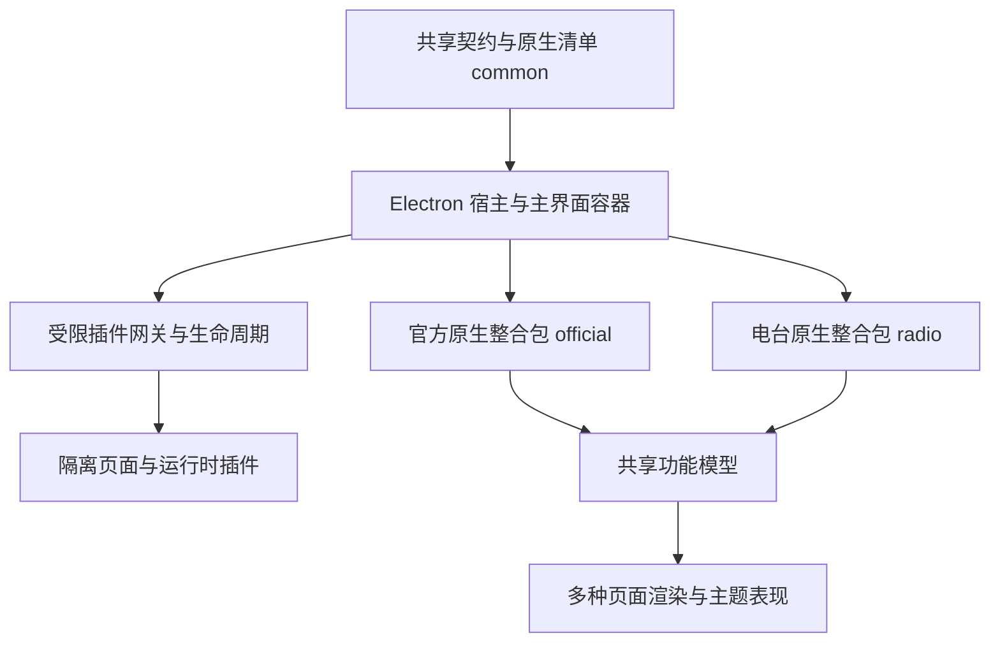

# 项目架构与目录说明

[架构索引](README.md) · [Agent 工作指南](../guides/agent-workflow.md)

本页于 **2026-10-21** 按当前工作区重写，用于定位当前实现。早期的“所有业务都在顶层 views”“状态使用 Pinia”等描述不适用于当前代码；历史计划中的旧目录只用于追溯。

## 整体结构

项目使用 Electron、Vue 3、TypeScript/JavaScript 和 webpack。宿主负责窗口、路由容器、安全边界、适配器与恢复入口；业务主要分布在官方和电台原生整合包；第三方插件通过隔离桥接贡献页面、视图、主题或扩展处理。

这里的原生整合包是随源码编译的受信任实现。隔离第三方插件不因此获得宿主的 Node、文件系统、任意 IPC 或其他插件内部状态。

## 顶层目录

| 目录/文件 | 职责 |
| --- | --- |
| [src/](../../src/) | 共享契约、主进程、主界面、桌面歌词、语言与静态插件产物 |
| [build-config/](../../build-config/) | 开发启动、webpack、插件生成、测试与安装包构建 |
| [plugin-samples/](../../plugin-samples/README.md) | 可读的插件清单、页面和扩展运行时样例 |
| [doc/](../README.md) | 当前指南、SDK、功能说明、历史计划和记录 |
| [resources/](../../resources/) | 平台图标等打包资源 |
| [publish/](../../publish/) | 发布脚本及发布信息，执行前核对授权 |
| [licenses/](../../licenses/) | 随安装包分发的许可文本 |
| [package.json](../../package.json) | 版本、依赖、环境约束及 npm 入口 |

`dist/` 是编译产物，`build/` 是安装包输出，`.runtime/` 常用于本机验收证据；这些目录不应当作源码权威入口，也不保证随仓库分发。全量构建会清理 `dist/` 与 `build/`。

## 共享契约：src/common

| 入口 | 负责内容 |
| --- | --- |
| [bundles/](../../src/common/bundles/) | `official.json`、`radio.json`、功能 inventory、设置分组与原生包构建身份 |
| [features.ts](../../src/common/features.ts) | 功能与渲染选择契约 |
| [pages/](../../src/common/pages/) | 页面定义；registry 从原生整合包清单派生页面列表 |
| [collection/](../../src/common/collection/) | 集合快照、命令和选择等协议 |
| [plugin/](../../src/common/plugin/) | API 版本、清单、安全、依赖、设置与扩展 schema |
| [theme/](../../src/common/theme/) | 主题语义、兼容 token、外观类型和校验 |
| [dj/](../../src/common/dj/) | 模型服务桥接相关共享定义与 DJ IPC |
| [ipcNames.ts](../../src/common/ipcNames.ts) | 模块式 IPC 名称映射；与 mainIpc/rendererIpc 配合使用 |
| [defaultSetting.ts](../../src/common/defaultSetting.ts) | 应用设置默认值；插件声明参数另走插件 settings 契约 |

修改协议时同时核对生产方、消费方、权限校验与兼容测试。不要只加类型而遗漏运行时校验。

## 主进程：src/main

入口为 [index.ts](../../src/main/index.ts) 与 [app.ts](../../src/main/app.ts)。窗口、托盘、热键、自定义音源等系统能力在 [modules/](../../src/main/modules/)；原生业务服务在 [bundles/](../../src/main/bundles/)。

| 入口 | 负责内容 |
| --- | --- |
| [modules/plugin/](../../src/main/modules/plugin/) | 签名与安装、服务编排、生命周期、协议、隔离视图与 runtime/preload |
| [modules/collection/](../../src/main/modules/collection/) | 主进程集合接线与受限访问 |
| [modules/winMain/](../../src/main/modules/winMain/) | 主窗口创建与生命周期 |
| [modules/winLyric/](../../src/main/modules/winLyric/) | 桌面歌词窗口 |
| [bundles/official/](../../src/main/bundles/official/) | 官方整合包的主进程接入 |
| [bundles/radio/](../../src/main/bundles/radio/) | 电台请求、TTS、凭据 vault 与音色目录 |

旧 `src/main/modules/dj/` 已迁入 `src/main/bundles/radio/`。新增系统能力应先判断所属整合包、宿主职责与调用者权限，不能仅因需要文件系统就开放给隔离插件。

## 主界面：src/renderer

[main.ts](../../src/renderer/main.ts)、[App.vue](../../src/renderer/App.vue) 和 [router.ts](../../src/renderer/router.ts) 负责启动与容器接线。路由从共享清单生成，侧栏通过统一页面层取得定义；新增原生页面要同步清单与功能注册。

| 入口 | 负责内容 |
| --- | --- |
| [bundles/official/features/](../../src/renderer/bundles/official/features/) | 搜索、列表、歌单、排行榜、下载、设置等共享功能模型 |
| [bundles/official/views/](../../src/renderer/bundles/official/views/) | 原版业务页面和组件 |
| [bundles/official/renderers/](../../src/renderer/bundles/official/renderers/) | 其他渲染、主题视图与 shell 表现 |
| [bundles/official/services/runtime/](../../src/renderer/bundles/official/services/runtime/) | 从旧 useApp 迁入的业务初始化、播放、同步与更新等服务 |
| [bundles/radio/](../../src/renderer/bundles/radio/) | 电台功能模型、页面、对话渲染、composables、store、工具和播放扩展 |
| [core/features/](../../src/renderer/core/features/) | 功能与 view 注册、服务、启停状态和组件加载 |
| [core/pages/](../../src/renderer/core/pages/) | 主窗口与侧栏的统一页面模型 |
| [core/collection/](../../src/renderer/core/collection/) | 适配器、controller、gateway、provider、session 与选择模型 |
| [core/player/](../../src/renderer/core/player/) | 公共播放器和扩展接入；电台专属音频在 radio/player |
| [core/pluginExtensions.ts](../../src/renderer/core/pluginExtensions.ts) | 宿主对扩展点的白名单调用 |
| [core/pluginCatalog.ts](../../src/renderer/core/pluginCatalog.ts) | 插件目录加载与请求协调 |
| [core/theme.ts](../../src/renderer/core/theme.ts)、[core/theme/](../../src/renderer/core/theme/) | 主题状态、外观、身份与图标 |
| [components/](../../src/renderer/components/) | 宿主布局、公共控件、功能容器、插件、集合、设置与主题组件 |
| [store/](../../src/renderer/store/) | 由 Vue 响应式 API 组织的共享状态，不能按 Pinia 假设改写 |
| [utils/musicSdk/](../../src/renderer/utils/musicSdk/) | 音乐来源访问与适配 |

顶层 `views/` 当前主要保留插件页面入口；不要按旧文档在这里重建 Search、List、Dj 或 Setting。顶层 `core/useApp/` 保留宿主初始化，业务运行时已迁入 official/services/runtime。

## 其他源码

- [src/renderer-lyric/](../../src/renderer-lyric/)：桌面歌词独立界面。
- [src/lang/](../../src/lang/Readme.md)：语言 JSON、注册和 i18n；当前四种语言由 index.ts 注册。
- [src/static/](../../src/static/)：由构建按配置处理的静态资源，其中 `plugins/` 是插件包生成位置。不要手工编辑生成包来替代修改样例与源码。

## 如何选择修改位置

1. 先查功能的拥有者、注册和渲染；同一功能可能有原版、简洁版或主题视图。
2. 修改业务规则优先落在 feature 或相应 service；修改外观落在 view/renderer 与主题层。
3. 涉及集合命令，通过 controller/gateway 校验身份、选择和 revision；不把真实宿主对象交给隔离页面。
4. 新增 IPC 从真实常量及注册器出发，校验发送者、数据范围和取消，不手写猜测的频道名。
5. 新增插件能力同时维护契约、权限、依赖、运行时与 SDK，并按 [验证指南](../guides/validation.md) 检查实际调用路径。

本页描述当前分层和源码位置，不构成完整架构验收。设计演变与仍未完成的通用扩展能力见 [计划索引](../plans/README.md) 与 [验收记录](../records/README.md)。
